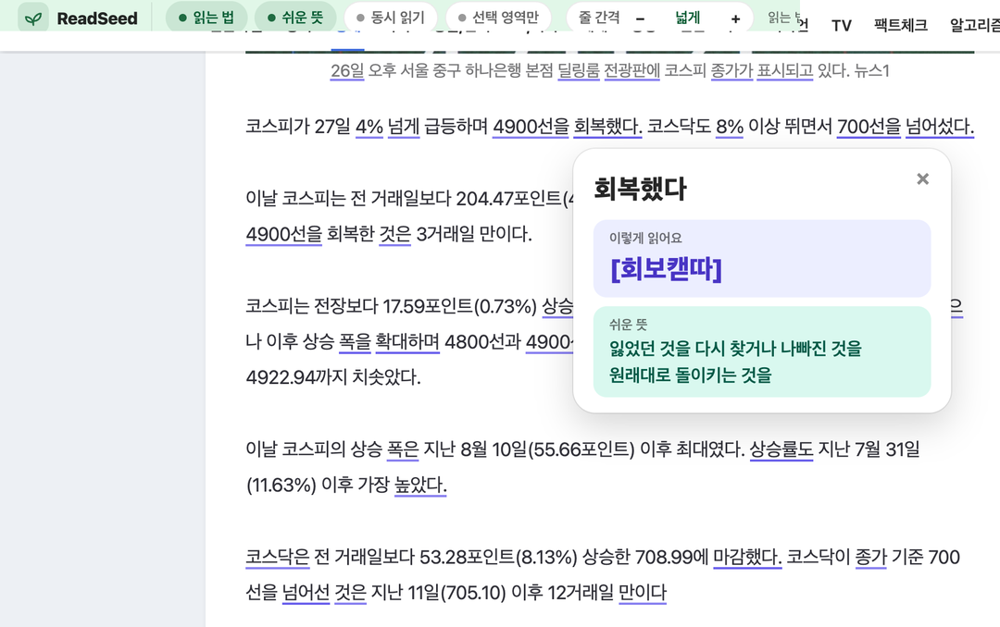
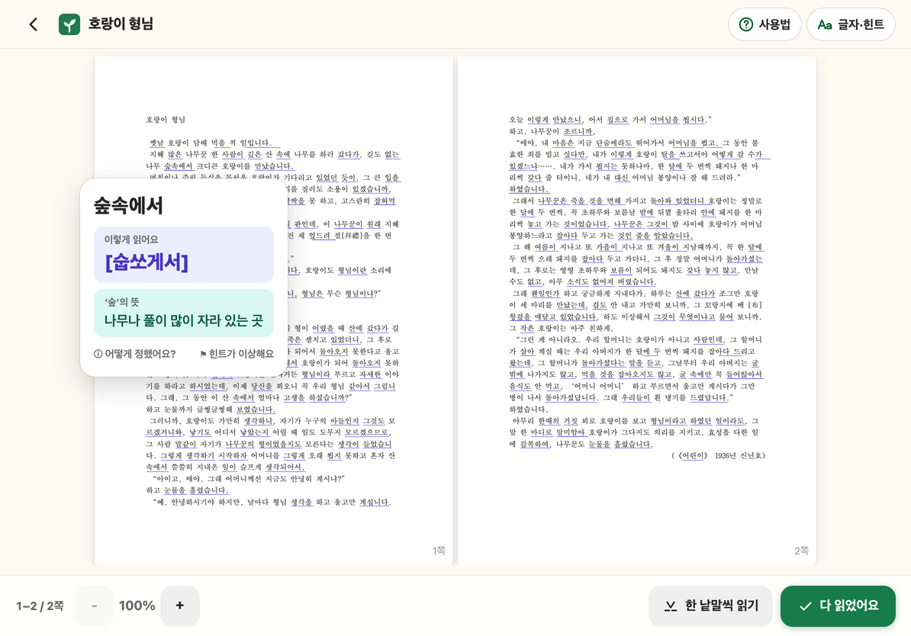

# ReadSeed (리드씨드)

난독증 아동이 치료사와 대면 수업을 한 뒤, **집에서 혼자 반복해서 복습하도록 돕는 한국어 읽기 보조 도구**.
아이패드용 웹앱과 크롬 확장 프로그램으로 쓴다.

> **대신 읽어 주는 것이 아니라, 함께 읽는다.** 글은 그대로 두고, 아이가 막히는 낱말에만 읽는 법과 쉬운 뜻을 곁에 보여 준다.

**👉 서비스 바로가기: [readseed.online/app](https://readseed.online/app/)**

## 사용 예시

| 크롬 확장 프로그램 | 아이패드 웹앱 |
|---|---|
|  |  |
| 뉴스 기사를 그대로 둔 채 힌트 낱말에 밑줄을 긋고, 누르면 카드를 띄운다. | 책을 두 쪽으로 펼쳐 읽다가, 막힌 낱말을 누르면 읽는 법과 쉬운 뜻이 나온다. |

## 원칙

- **원문 보존**: 글을 바꾸거나 요약하지 않는다. 힌트는 원문 위 별도 레이어로만 그린다.
- **막히는 곳에만**: 모든 낱말에 힌트를 달지 않는다. 아이가 밑줄 친 낱말을 눌렀을 때만 보여 준다.
- **확실할 때만**: 틀린 힌트는 없는 것보다 나쁘다. 확신이 낮으면 보여 주지 않는다.
- **발음은 규칙·사전이, 뜻은 사전 + AI가**: 발음은 표준발음법 규칙과 국립국어원 사전으로 정한다. AI는 사전 뜻 후보 중 문맥에 맞는 것을 고르고, 그 뜻을 아이 눈높이의 쉬운 말로 다시 쓰는 일만 한다.

## 기능

### 웹앱 (아이패드)

| 기능 | 설명 |
|---|---|
| 책장 | 선생님이 고른 읽기 책 PDF와 짧은 연습 글. 표지를 누르면 바로 펼쳐진다 |
| 내 글 읽기 | 교과서·학습지 PDF 열기, 글 붙여 넣기(2,000자까지) |
| PDF 책 보기 | 가로 화면은 두 쪽 펼침, 세로 화면은 한 쪽. 화면 오른쪽을 누르면 다음 쪽, 왼쪽은 앞 쪽(밀기·화살표 키도 됨). ＋/－로 확대 |
| 밑줄 힌트 | 밑줄 친 낱말을 누르면 카드가 열린다. **이렇게 읽어요** `[구지]` → **쉬운 뜻**(문장 속 꼴에 맞춘 쉬운 말, 예: 떠오르자 → 위로 올라가자) |
| 한 낱말씩 읽기 | 낱말을 하나씩 짚어 가며 함께 읽는다(이전·재생·다음). PDF에서는 아이가 누른 낱말부터 보이는 순서대로 이어 읽는다 |
| 오늘의 읽기 | 하루 한 음운변동(연음·구개음화 등)에 맞춘 짧은 글. 밑줄 없이 혼자 읽고, 막힌 낱말만 눌러 답을 본다 |
| 다 읽었어요 · 낱말 공부 | 힌트를 본 낱말만 카드로 복습한다. 아이가 먼저 소리 내어 읽고 답을 열어 스스로 맞았는지 고른다 |
| 낱말 공책 | 힌트를 본 낱말이 기기에 모인다. 다른 날 혼자 맞게 읽을 때마다 별이 하나씩, 3개면 ‘다 익힌 낱말’ |
| 아이별 맞춤 | 공책 기록으로 자주 막히는 음운변동은 힌트를 꼭 보이고, 익힌 변동은 줄인다 |
| 글자·힌트 설정 | 글자 크기·줄 간격·글자 사이·바탕색, 힌트 양, 읽기 속도 |
| 보호자·선생님 | AI가 확신하지 못한 뜻과 아이가 신고한 힌트 검토, 기록 내보내기·지우기 |
| 작동 기록 | 카드의 ‘어떻게 정했어요?’에서 그 문장을 처리한 과정(형태소 → 발음 규칙/사전 → 뜻 후보 → AI 판단 → 표시 여부)을 보여 준다 |

영어처럼 한글이 거의 없는 글은 분석하지 않고 "한국어 글만 도와줄 수 있어요"라고 안내한다. 스캔 PDF(글자 정보 없는 그림)에는 아직 힌트를 주지 않는다.

### 크롬 확장 프로그램

웹페이지에서 ReadSeed 아이콘을 누르면 상단에 도구 막대가 열린다.

- **분석하기**: 기사 본문(또는 드래그한 부분만)을 분석해 힌트 낱말에 밑줄을 긋는다. 누르면 웹앱과 같은 카드가 뜬다.
- **줄 간격**: 분석한 문단의 줄 간격을 넓힌다(원래대로·넓게·더 넓게·아주 넓게). 원문은 바꾸지 않고 끄면 원래대로 돌아간다.
- **동시 읽기**, **선택 영역만**.
- PDF 탭에서는 ReadSeed PDF 뷰어로 열어 같은 밑줄·카드를 보여 준다.
- 아이콘을 누른 탭에만 스크립트를 넣는다(`activeTab`).

## 평가

| 항목 | 결과 |
|---|---|
| 발음 — 국립국어원 한국어기초사전 표준 발음 55,306어절(독립 정답셋) | 정밀도 98.59%, 재현율 98.37%. 순환이 없는 활용형만 보면 정밀도 98.1% |
| 발음 — 팀 골드셋 49개(실제 문서 10개 포함) | 정밀도·재현율 100% |
| 숫자 읽기(3마리[세 마리], 3학년[삼 학년]) 40건 | 전부 통과 |
| 쉬운 뜻 — 모두의 말뭉치 문장 50문항, 두 라벨러 독립 라벨(50문항 모두 일치) | 45개 표시, 37개가 정답 뜻과 일치(정밀도 82.2%). 틀린 것은 대부분 월세·수색처럼 아주 가까운 뜻끼리 |

자동 테스트 82개로 발음·뜻·API 동작을 확인한다.

## 데이터 소스

| 소스 | 용도 |
|---|---|
| 국립국어원 한국어기초사전 (CC BY-SA 2.0 KR) | 뜻 후보(표제어 56,555 · 뜻 76,833), 낱말별 표준 발음, 발음 독립 정답셋 |
| 국립국어원 우리말샘 | 로컬 사전에 없는 낱말 보조 조회 |
| 국립국어원 모두의 말뭉치(형태 분석) | 형태소 분석 검증(Kiwi 일치 80.1%), 뜻 라벨링 문장. 말뭉치 문장은 재배포하지 않는다 |
